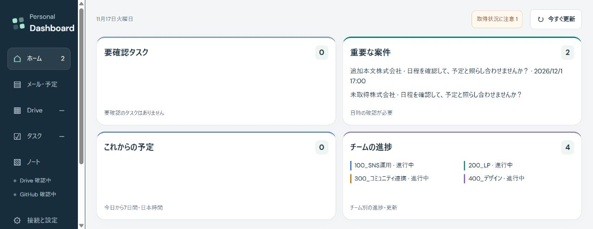
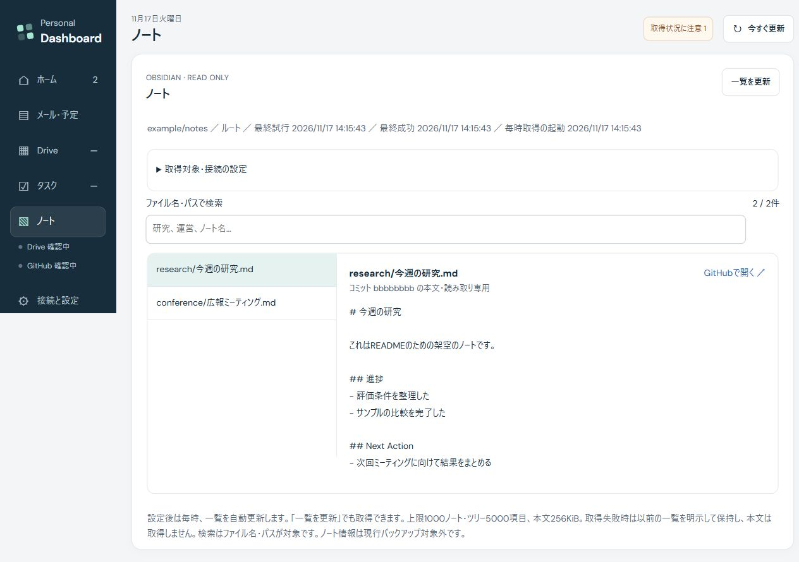

# Personal Dashboard

GitHub Projects、重要メール、カレンダー、Driveを一画面から確認する、開発者本人専用のダッシュボードです。
ソースコードはPublicですが、**本番のデータと操作はGitHubアカウントの本人IDで制限**しています。一般利用者向けの登録・共有サービスではありません。

[本番サイト](https://personal-dashboard.kait0.workers.dev/) · [アクセス制御](SECURITY.md) · [検証・運用](docs/operations.md)

## 画面

以下は実際の画面を架空データで撮影したサンプルです。実メール、非公開ノート、接続トークンは含みません。接続や取得成功を証明する本番画像ではありません。

### ホーム

必要な情報を4ブロックにまとめ、押したときに詳細を開きます。重要案件はメールをまとめて表示し、提案・締切・確認待ちを確認できます。



### Driveのチーム進捗

チームカラー付きの2×2ブロックから、進捗・次にすること・期限を編集できます。ファイルの更新者・更新日時は詳細で確認します。進捗の保存でDriveの元ファイルは変更しません。


### ノート

指定したGitHubリポジトリ以下のMarkdownを、ファイル名・パスで検索して閲覧します。本文は選択時だけ読み取り、外部画像やスクリプトを実行しません。



## 現行機能

| 機能 | できること | 現在の制約 |
| --- | --- | --- |
| GitHub Projects | 複数Project・タスクの状態と期限の双方向同期 | 外部との原子的な更新・完全な競合防止は不可 |
| メール・予定 | 複数Googleアカウント、表示名、毎時取得、重要案件の提案、日時確定 | 重要度・日時はルール判定。全メールの重要判定・本文の完全取得は保証しない |
| 予定登録 | 内容確認、全接続のメインカレンダーとの照合、登録後の再取得 | 本人の確認が必須。照合後の外部追加との競合は防げない |
| Drive | サブフォルダを含む毎時取得、未確認管理、個人作業の分離、チーム進捗 | 更新メタデータ中心。ファイル本文の差分比較は対象外 |
| ノート | 一覧の毎時更新、手動更新、検索、読み取り専用表示 | 本番は専用トークンの登録待ち。編集・本文検索は未対応 |
| バックアップ | サイト内から対応データの保存・確認付き復元 | 接続資格情報・ノート一覧・Slackは含まない。画面の対象範囲を確認する |
| Windows | Chromeから独立ウィンドウとしてインストール | 壁紙風表示・iOS版は未実装 |

Slackは対象ワークスペースのアプリ上限により接続できておらず、現行版の通常メニューから非表示にしています。議事録を使った週報は追加のGoogle Docs読み取り認可が必要です。認可前に本文を取得したり、元の議事録へ書き込んだりしません。

## 使い方

1. 本番サイトでGitHubログインします。サーバーで固定の本人IDを照合します。
2. ホームのブロックから、案件・予定・チーム・タスクの詳細を開きます。
3. Googleアカウントの追加・命名・停止や取得状況は「メール・予定」→「アカウント・取得状況・設定」で管理します。
4. 取得エラー、古いキャッシュ、未同期、結果未確認は注意表示から確認します。「成功」と表示されるまでは未反映として扱います。

### 非公開ノートの接続

本番のノートは、専用の接続設定が未完了です。Projects用のOAuth認可やPCの`gh`トークンを流用しません。

1. 「ノート」→「取得対象・接続の設定」を開きます。
2. GitHubでFine-grained personal access tokenを作成します。Resource ownerは本人、**Only select repositoriesで対象1件だけ**、Contentsは**Read-only**、有効期限を設定します。Metadataの読み取りはGitHubが自動で付与します。
3. トークンをサイトの非表示入力欄へ直接貼り付け、対象を確認して保存します。チャット・README・コミット・URLへ貼らないでください。
4. 保存時の一覧取得が成功したことを確認します。設定後は毎時更新し、最終試行・最終成功・定期取得の起動時刻を区別して表示します。失効時は専用トークンを再発行してください。

`*_L.md`は階層・大文字小文字を問わず一覧保存と本文取得から除外します。上限は1000ノート、ツリー5000項目、一覧512KiB、本文256KiB。GitHubが一覧を省略した場合も完了扱いにしません。非公開ノートや個人情報を、このPublicリポジトリへ追加しないでください。

[GitHub公式：Personal access tokenの管理](https://docs.github.com/en/authentication/keeping-your-account-and-data-secure/managing-your-personal-access-tokens)

## 開発・検証

構成は素のJavaScript／HTML／CSS、Motion、Cloudflare Workers、SQLite Durable Objectです。Python試作とは別実装です。D1・React・AI APIは使用していません。

Windows PowerShellで実行します。

```powershell
npm.cmd ci
npm.cmd test
npm.cmd run build
npm.cmd run dev
```

既定のローカルURLは `http://localhost:8787`。ローカルでも本人認可が必要です。テストは模擬APIを使用し、通常の実行で実メール・予定・Driveを書き換えません。実サービスの接続設定がないクローンは、本人の本番保存領域に接続できません。

デプロイは対象CloudflareアカウントとWorker名を確認してから `npm.cmd run deploy`。設定・秘密値の管理と検証結果は[運用資料](docs/operations.md)を参照してください。

## 残っていること

- 非公開ノート用トークンの本人登録、本番一覧・本文・初回の毎時取得確認。
- Google Docsの追加認可後、実議事録からの週報下書きの確認。
- 小型画面・拡大表示の追加確認。高さが小さい場合はスクロールを許します。
- Slack接続、ノート編集、壁紙風表示、iPad／iPhoneへの展開。

ソース公開は本番の利用権限を与えるものではありません。一方で、Publicソースの閲覧・複製や、第三者が別環境で改変して動かすことは本番の認可では防げません。
