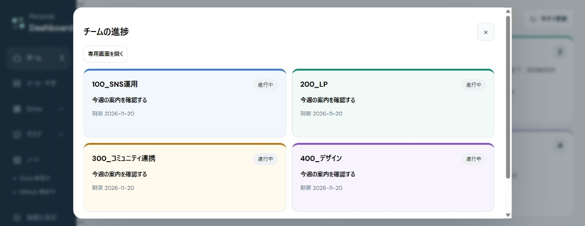
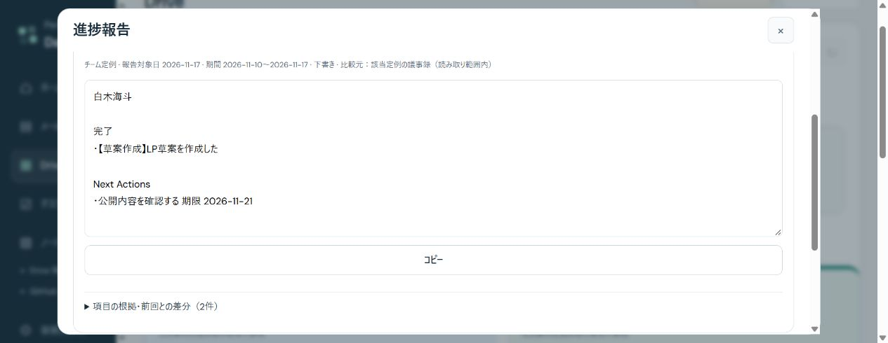

# Personal Dashboard

GitHub Projects、重要メール、カレンダー、Driveを一画面から確認する、開発者本人専用のダッシュボードです。
ソースコードはPublicですが、**本番のデータと操作はGitHubアカウントの本人IDで制限**しています。一般利用者向けの登録・共有サービスではありません。

[本番サイト](https://personal-dashboard.kait0.workers.dev/) · [アクセス制御](SECURITY.md) · [検証・運用](docs/operations.md)

## 画面

以下は実際の画面を架空データで撮影したサンプルです。実メール、非公開ノート、接続トークンは含みません。接続や取得成功を証明する本番画像ではありません。

### ホーム

必要な情報を4ブロックにまとめ、押したときに詳細を開きます。重要案件はメールをまとめて表示し、提案・締切・確認待ちを確認できます。


### Driveのチーム進捗

チームカラー付きの2×2ブロックから資料と報告へ進みます。手入力の進捗・期限の設定を常時並べず、「進捗報告」1つの入口を上へ、表示設定を下へ置きました。元のDriveファイルは変更しません。



### 定例の進捗報告

選択したDocs・Sheetsから、本人のチーム定例、担当チーム全体のOrganizer定例、短い全体定例の下書きを作ります。根拠・未取得・矛盾を確認して編集でき、下書きと実際に使用した確定版を区別して保存します。確定版を優先して前回と比較します。



詳しい対象範囲・読み取り形式・制約は[定例報告の使い方](docs/progress-reports.md)を参照してください。

### ノート

指定したGitHubリポジトリ以下のMarkdownを、ファイル名・パスで検索して閲覧します。本文は選択時だけ読み取り、外部画像やスクリプトを実行しません。


## 現行機能

| 機能 | できること | 現在の制約 |
| --- | --- | --- |
| GitHub Projects | 複数Project・タスクの状態と期限の双方向同期 | 外部との原子的な更新・完全な競合防止は不可 |
| メール・予定 | 複数Googleアカウント、表示名、毎時取得、重要案件の提案、日時確定 | 重要度・日時はルール判定。全メールの重要判定・本文の完全取得は保証しない |
| 予定登録 | 内容確認、全接続のメインカレンダーとの照合、登録後の再取得 | 本人の確認が必須。照合後の外部追加との競合は防げない |
| Drive | サブフォルダを含む毎時取得、未確認管理、個人作業の分離、チーム別の資料・報告 | 更新メタデータ中心。ファイル本文の差分比較は対象外 |
| 定例報告 | 複数資料の読み取り、対象期間・担当・段階の整理、根拠、履歴、前回確定版比較 | Docs・Sheetsの追加認可が必要。対応書式と取得上限あり |
| ノート | 一覧の毎時更新、手動更新、検索、読み取り専用表示 | 本番の接続・一覧・本文・手動更新・実Cronを確認済み。編集・本文検索は未対応 |
| バックアップ | サイト内から対応データの保存・確認付き復元 | 定例報告は報告画面から別途保存・復元。接続資格情報・ノート一覧・Slackは含まない |
| Windows | Chromeから独立ウィンドウとしてインストール | 壁紙風表示・iOS版は未実装 |

Slackは対象ワークスペースのアプリ上限により接続できておらず、現行版の通常メニューから非表示にしています。定例報告にはGoogle Docs・Sheetsの追加読み取り認可が必要です。権限がない資料は読めない理由を表示し、元の資料へは書き込みません。

## 使い方

1. 本番サイトでGitHubログインします。サーバーで固定の本人IDを照合します。
2. ホームのブロックから、案件・予定・チーム・タスクの詳細を開きます。
3. Googleアカウントの追加・命名・停止や取得状況は「メール・予定」→「アカウント・取得状況・設定」で管理します。
4. 取得エラー、古いキャッシュ、未同期、結果未確認は注意表示から確認します。「成功」と表示されるまでは未反映として扱います。

### 非公開ノートの接続

本番のノートは専用トークンで接続済みです（2026-11-17）。以下は再設定時の手順です。Projects用のOAuth認可やPCの`gh`トークンを流用しません。

1. 「ノート」→「取得対象・接続の設定」を開きます。
2. GitHubでFine-grained personal access tokenを作成します。Resource ownerは本人、**Only select repositoriesで対象1件だけ**、Contentsは**Read-only**、有効期限を設定します。Metadataの読み取りはGitHubが自動で付与します。
3. トークンをサイトの非表示入力欄へ直接貼り付け、対象を確認して保存します。チャット・README・コミット・URLへ貼らないでください。
4. 保存時の一覧取得が成功したことを確認します。設定後は毎時更新し、最終試行・最終成功・定期取得の起動時刻を区別して表示します。失効時は専用トークンを再発行してください。

`*_L.md`は階層・大文字小文字を問わず一覧保存と本文取得から除外します。上限は1000ノート、ツリー5000項目、一覧512KiB、本文256KiB。GitHubが一覧を省略した場合も完了扱いにしません。非公開ノートや個人情報を、このPublicリポジトリへ追加しないでください。

[GitHub公式：Personal access tokenの管理](https://docs.github.com/en/authentication/keeping-your-account-and-data-secure/managing-your-personal-access-tokens)

## 開発・検証

構成は素のJavaScript／HTML／CSS、Motion、Cloudflare Workers、SQLite Durable Objectです。Python試作とは別実装です。D1・React・AI APIは使用していません。

Windows PowerShellで実行します。

```powershell
npm.cmd ci
npm.cmd test
npm.cmd run build
npm.cmd run dev
```

既定のローカルURLは `http://localhost:8787`。ローカルでも本人認可が必要です。テストは模擬APIを使用し、通常の実行で実メール・予定・Driveを書き換えません。実サービスの接続設定がないクローンは、本人の本番保存領域に接続できません。

デプロイは対象CloudflareアカウントとWorker名を確認してから `npm.cmd run deploy`。設定・秘密値の管理と検証結果は[運用資料](docs/operations.md)を参照してください。

## 残っていること

現在の優先順（iPhone／iPad実機確認・通知領域の実アイコン操作・表示確認・Slack・DevHubは保留）：

1. ノート編集：画面内の下書き編集・コピー・Markdown保存を実装、全392テスト・ビルド成功。本番未反映。下書きの永続化・GitHub直接保存・書き込み権限設定は未完了。[範囲と制約](docs/note-editing.md)。
2. Windowsの複数モニター変更への対応と検証。
3. 実際に使用した定例報告との比較確認（実際の使用を待つ）。

Windowsの壁紙風表示は実装・ネイティブ24項目検証済み。本人ログイン後のホーム表示、背面への移動、通常表示への復帰を確認しています。[起動方法と制約](windows/README.md)。

iPad／iPhoneのホーム画面追加案内・起動状態判定は本番反映済みです。実機確認は保留、ネイティブ／TestFlight版は未実装です。

実際に使用した定例報告との確定版比較は、使用実績ができてから検証します。

標準の重要メール判定は本文最大6,000文字を対象にし、整理する前に本文後半の対応事項も確認します。カスタム語句の判定は保存済み先頭1,600文字が対象です。分類誤り、上限より後、添付・リンク先の見落としは残るため、Gmail原文への導線を維持します。

- 定例報告を実際に定例で使用した後の確定版比較。まだ実際の使用はないため、本番は下書きのまま保持しています。保存拡張・履歴整理・復元の検証範囲は[検証記録](docs/progress-reports.md#今回の検証状況)を参照してください。
- 他ブラウザー・OS文字拡大の追加確認。320px・390px幅、狭い表示領域、Windows Chromeの200%表示は確認済みです。高さが小さい場合は縦スクロールを許します。
- Slack接続、ノート編集、iPad／iPhoneへの展開。

ソース公開は本番の利用権限を与えるものではありません。一方で、Publicソースの閲覧・複製や、第三者が別環境で改変して動かすことは本番の認可では防げません。

## 整理済みメールを個別に保存する

「メール・予定」の取得済み一覧で「その他」を選び、必要なメールを開きます。「このメールを重要として本文を再取得」で対象を確認すると、1通だけを読み直して重要メールとして保存します。「自動判定に戻す」で本人指定を解除できます。Gmailの原文・既読状態は変更しません。

保存は既存の取得範囲内（直近14日・取得済み一覧）です。永久保存ではなく、一覧外になったメールやキャッシュを整理した場合は本人指定も残りません。本文表示は最大1,600文字、日時確認は最大6,000文字です。容量不足や取得失敗では以前の内容を保持します。確定日時や予定登録の関連記録は、自動判定へ戻しても保護します。

## ノートの本文検索

「ノート」の検索語を入力し「本文を検索」を押します。現在の一覧を5件ずつ読み取り、一致するノートの行番号と抜粋を表示します。「続きの5件を検索」で残りを進め、結果を押すと本文を開けます。通常のファイル名・パス検索にも戻せます。

本文検索済み件数、未検索の続き、256KiBのサイズ上限による対象外、取得失敗を区別します。表示された検索結果は検索済みの範囲だけです。一覧の対象・コミットが変わった場合は検索し直します。検索語と本文は永続保存せず、毎時の更新は引き続き一覧だけです。`*_L.md`は検索でも取得しません。

## 4チームの状況と重要資料

ホームまたはDriveの4チームカードを押すと、自分が状況を把握するための詳細を開きます。実際のファイル更新・更新者、自分用の状況メモ・期限、重要資料を確認できます。定例報告の生成は「進捗報告」から別に行います。更新件数を完了率へ変換することはありません。

「重要資料を選ぶ・自分用メモを編集」で、取得済みDrive資料をファイル名・保存場所から探し、チームごとに最大5件追加して保存します。共通資料を複数チームへ選ぶことも可能です。個人作業フォルダは候補外です。選択後は資料を押すと既存のDrive詳細・元ファイルへの導線を利用できます。

保存対象はファイルIDなので、次回取得で資料名や更新者を追従します。取得範囲から外れた資料は参照不可と表示し、勝手に別の資料へ差し替えません。選択解除はこのサイトの参照設定だけを変更し、元ファイルは削除しません。状況メモと重要資料の選択は既存バックアップの対象です。

同名資料を区別できるよう保存場所を添えています。チーム詳細を下へスクロールしても、見出しと閉じるボタンは上部に残ります。

## ノートとGitHubタスクの関連

ノート本文を開き、「GitHubタスクとの関連」を展開して取得済みタスクを選びます。関連付けたタスクはこの画面から開けます。タスク一覧が古い場合は「タスク」で一覧を更新し、関連一覧を読み直してください。

保存するのは参照先だけです。ノート本文・GitHubタスクは変更しません。全体200件まで、重複は作らず、複数画面の古い版からの保存を停止します。結果不明の場合は再送前に一覧を読み直してください。ノートの接続・取得範囲を変更しても関連は残り、参照不可表示から解除できます。解除はこのサイトの関連だけを消します。関連は既存バックアップで保存・空の保存先へ復元でき、再接続まで参照不可となります。
